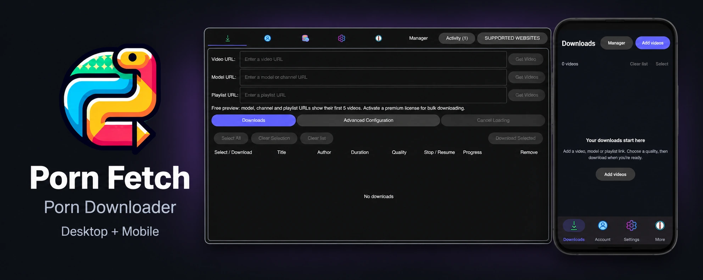

<div align="center">
<h1>
  
</h1>
<a href="https://github.com/EchterAlsFake/Porn_Fetch/actions/workflows/build_all.yml"></a>
<a href="https://github.com/EchterAlsFake/Porn_Fetch/workflows/CodeQL"></a>


<br>

<a href="https://pornfetch.to/checklist">
  
</a>

---

**[<kbd><strong>&nbsp;<br>&nbsp;Download (v3.9)&nbsp;<br>&nbsp;</strong></kbd>](https://github.com/EchterAlsFake/Porn_Fetch/releases/tag/v3.9.0)** 
**[<kbd><strong>&nbsp;<br>&nbsp;Screenshots&nbsp;<br>&nbsp;</strong></kbd>](https://github.com/EchterAlsFake/Porn_Fetch/blob/master/docs/SCREENSHOTS.md)** 
**[<kbd><strong>&nbsp;<br>&nbsp;Supported Websites&nbsp;<br>&nbsp;</strong></kbd>](https://github.com/EchterAlsFake/Porn_Fetch/blob/master/docs/WEBSITES.md)** 
**[<kbd><strong>&nbsp;<br>&nbsp;Installation Guide&nbsp;<br>&nbsp;</strong></kbd>](docs/INSTALLATION.md)** 
**[<kbd><strong>&nbsp;<br>&nbsp;Changelog&nbsp;<br>&nbsp;</strong></kbd>](https://github.com/EchterAlsFake/Porn_Fetch/blob/master/docs/CHANGELOG.md)** 
**[<kbd><strong>&nbsp;<br>&nbsp;Development Checklist&nbsp;<br>&nbsp;</strong></kbd>](https://pornfetch.to/checklist)** 

---
</div>

> [!CAUTION]
> Porn Fetch is an unofficial project and is not endorsed, sponsored, nor explicitly approved by its supported Websites. 
> Certain features of Porn Fetch are prohibited or restricted in [these countries](docs/PROHIBITED_COUNTRIES)

## 🚀 Quick Links
- [Features](#-features)
- [Installation & Building](#-installation--building-from-source)
- [Premium License](#premium-license)
- [GitHub Workflow Targets](#github-workflow-targets)
- [Supported Websites](#-supported-websites)
- [Translating](#-translating)
- [Developer Guide](docs/FOR_DEVELOPERS.md)
- [Credits](#-credits)
- [License](#-license)

## 🌟 Features
- Cross-platform
- 15+ Supported Adult Sites
- Downloading Videos
- Downloading Playlists
- Downloading whole model / channel accounts
- Login to your accounts and fetch your liked videos, own playlists and more
- Native Tor Integration to bypass censorship
- Custom SNI Proxy to hide destination websites
- Encrypted DNS by default 
- Statistics tracking with an integrated local database
- Multithreaded downloading
- Automatic resuming
- Installer updates for desktop builds and signed self-updates for standalone CLI builds
- Custom template for filenames based on video metadata
- CLI for experienced users
- Material UI Interface with theming options
- Accessibility e.g., high contrast, screen reader support
- Proxy support for all proxy types and authentication
- Extremely configurable for experienced users
- In-App speed limit
- Bind Porn Fetch to a custom network interface e.g., a VPN
- Automatic file tagging (metadata)
- Automatic conversion from MPEG-TS to mp4 (within seconds)
- Build scripts for supported desktop and CLI targets
- Independent Open-Source [Server](https://github.com/EchterAlsFake/Server)
- Source-available application, made with ❤️ in 🇩🇪
- Actively maintained (yes, also for the next 5 years)

# Privacy and Anonymity
- The Server for Porn Fetch does NOT log nor track any of your data 
- You can route Porn Fetch's entire server traffic including error reports, licensing, updating through Tor
- I actually care about your privacy, which is the reason why I said no to: Cloudflare, Easy VPS routing, Cloud Hosting
- Porn Fetch's entire infrastructure lives in my home and is fully independent of Big Tech

## 📦 Installation & Building from Source

There are three ways to get Porn Fetch running:
1. **[Pre-built Binaries & Installers](#1-pre-built-binaries--installers)** (fastest)
2. **[One-Liner Install Scripts](#2-one-liner-install-scripts)** (automatic build)
3. **[Building from Source](#3-building--running-from-source)** (recommended for development)

> [!TIP]
> For the complete multi-platform guide with system package instructions and troubleshooting, see the [Installation & Build Guide](docs/INSTALLATION.md).

### 1. Pre-built Binaries & Installers
Grab the latest release for your platform from [GitHub Releases](https://github.com/EchterAlsFake/Porn_Fetch/releases):

- **Qt Installer Framework (`*_Setup` installers):**
  Installs the desktop application and configures the Qt `maintenancetool` for repository-based in-app updates.
  - **Windows:** `PornFetch_windows_GUI_x64_Setup.exe`
  - **Linux:** `PornFetch_linux_GUI_x64_Setup.run` (run `chmod +x` before launching)
  - **macOS:** `PornFetch_macos_GUI_Universal_Setup.dmg`
- **Standalone Portable Bundles (`.zip` / `.dmg`):**
  Extract the ZIP to any folder. Make sure the bundled `pocketbase` (or `pocketbase.exe`) stays right next to the app binary—Porn Fetch needs it for download tracking and queue management.
- **Standalone Headless CLI:**
  Single portable binary (`PornFetch_linux_CLI_x64`, `PornFetch_windows_CLI_x64.exe`, etc.) with built-in cryptographically verified self-updating:
  ```bash
  ./PornFetch_linux_CLI_x64 self-update --check
  ./PornFetch_linux_CLI_x64 self-update
  ```

### 2. One-Liner Install Scripts
To automatically install dependencies, clone, and build the latest code on your machine:

- **Linux & macOS:**
  ```bash
  curl -sSL https://raw.githubusercontent.com/EchterAlsFake/Porn_Fetch/master/scripts/install.sh | bash
  ```
- **Windows (PowerShell as Administrator):**
  ```powershell
  irm https://raw.githubusercontent.com/EchterAlsFake/Porn_Fetch/master/scripts/install_windows.ps1 | iex
  ```
  Missing Git and MSYS2 are installed automatically using winget. The script
  also prepares Microsoft C++ Build Tools, the Windows SDK, and the Clang toolchain
  for FFmpeg. Build failures stay visible and are logged under
  `%TEMP%\porn-fetch-build-logs`.

### 3. Building & Running from Source
The source tree targets Python 3.15 and uses [`uv`](https://docs.astral.sh/uv/) for dependency management.

```bash
# 1. Clone the repository
git clone https://github.com/EchterAlsFake/Porn_Fetch.git
cd Porn_Fetch

# 2. Sync dependencies (uv automatically provisions Python 3.15)
uv sync --extra gui --group dev

# 3. Fetch PocketBase (required for database and queue persistence)
uv run python scripts/fetch_pocketbase.py

# 4. Patch QtAsyncio (required for the GUI under Python 3.15)
uv run python scripts/patch_qtasyncio.py .venv

# 5. Launch the application!
uv run main.py              # Desktop GUI
uv run Porn_Fetch_CLI.py    # Headless CLI
```

> **Headless / Termux note:** If you only need the CLI (e.g. on headless servers or in Android Termux), you don't need any Qt dependencies or the QtAsyncio patch. Just run `uv sync` (or `pip install -e .` on Termux) and execute `uv run Porn_Fetch_CLI.py`.

### 4. Compiling Standalone Binaries from Source
To produce distributable single binaries yourself:
- **CLI binary:**
  ```bash
  uv run pyinstaller --clean packaging/pyinstaller_cli.spec
  ```
- **GUI executable:**
  ```bash
  uv run pyside6-deploy -c packaging/pysidedeploy_linux.spec    # Linux
  uv run pyside6-deploy -c packaging/pysidedeploy_windows.spec  # Windows
  # macOS: scan QML imports and generate a spec that excludes unused plugins:
  uv run --no-sync python packaging/prepare_macos_deploy.py --output /tmp/pornfetch-macos.spec
  uv run pyside6-deploy -c /tmp/pornfetch-macos.spec
  # Repair and re-sign the macOS bundle after deployment:
  uv run --no-sync python packaging/repair_macos_bundle.py "Porn Fetch.app"
  ```

## Premium license
Pay €29.99 once for a lifetime Premium license on up to ten active installations.
Every future Porn Fetch update and feature I release is included. Future development
has no guaranteed duration. Activation and periodic online validation remain required;
if I permanently close the licensing service, I will provide an offline unlock before
closure so existing buyers can continue using Premium.

Premium enables these features:

- Downloads above 720p.
- Bulk downloading from public models, channels and playlists.
- Parallel downloads.

Without an active premium license, public model, channel and playlist URLs show
only their first five videos. Account collections are exempt from this preview
limit. Free use supports up to 720p and one active download at a time.

In the GUI, use **Get lifetime Premium**, then paste the signed key or use
**Import License File**. In the CLI, choose **License Management** and enter the
key, JSON envelope, or file path. The current client accepts signed permanent
commercial licenses; old beta credentials are not upgraded automatically.
See the [installation guide](docs/INSTALLATION.md).

## General Information
#### GitHub Workflow Targets

| Platform                  | App                | Architectures                        | OS Version (GUI)               |
|---------------------------|--------------------|--------------------------------------|--------------------------------|
| **Windows**               | GUI, CLI           | x64, ARM64                           | 10+                            |
| **Linux (X11 / Wayland)** | GUI, CLI           | x64, ARM64, (experimental archs)     | Kernel 5.10+, BTF, glibc 2.28+ |
| **macOS**                 | GUI, CLI           | x86_64, ARM64  (Universal build)     | Sonoma 14.4+                   |
| **Android**               | GUI, CLI           | arm64-v8a, armeabi-v7a, x86_64, i686 | Android 9+, Custom OS possible |
| **iOS**                   | GUI, CLI           | arm64                                | iOS 15+                        |

##### About FreeBSD
FreeBSD should theoretically work, as Qt has full support for it, however I have never tested it. 
So you'd need to see for yourself, but I at least can guarantee you, that I have not made any application logic that stops you 
from using it xD 

#### Development Testing
Porn Fetch is tested actively on the following devices and systems:
- Arch Linux + Hyprland (DMS) :: Main Development Machine 
- Windows 11 
- iPhone 7 (iOS 15.8.8) 
- Xiaomi 15 (Android 16)
- Xiaomi Redmi 6 (Android 9)
- Teclast T50 Pro (kp Bruder) 
- virtual macOS Sequoia 

## 🌐 Supported Websites
- [PornHub.com](https://github.com/Egsagon/PHUB)
- [xnxx.com](https://github.com/EchterAlsFake/xnxx_api)
- [Eporner.com](https://github.com/EchterAlsFake/eporner_api)
- [XVideos.com](https://github.com/EchterAlsFake/xvideos_api)
- [xhamster.com](https://github.com/EchterAlsFake/xhamster_api)
- [spankbang.com](https://spankbang.com)
- [youporn.com](https://youporn.com)
- [beeg.com](https://github.com/echteralsfake/beeg_api)
- [porntrex.com](https://github.com/echteralsfake/porntrex_api)
- [xfreehd.com](https://github.com/echteralsfake/xfreehd_api)
- [redtube.com](https://redtube.com)
- [thumbzilla.com](https://thumbzilla.com)
- [tube8.com](https://tube8.com)
- [empflix.com](https://empflix.com)
- [tnaflix.com](https://tnaflix.com)
- [pornhat.com](https://github.com/EchterAlsFake/unofficial-api-for-pornhat) *
- [porndoe.com](https://github.com/EchterAlsFake/unofficial-api-for-porndoe) *

* = Current Development Branch

> [!IMPORTANT] 
> Not all websites support every feature. 
> Some providers support only direct videos while others also support profiles or collections.
> Searching is intentionally not available due to legal reasons

### You can find more information [HERE](https://github.com/EchterAlsFake/Porn_Fetch/blob/master/docs/WEBSITES.md)

### For Developers
If you want to develop on Porn Fetch and do local changes, contribute code or do whatever, please
have a look at the internal code documentation which explains the core structure of the project,
as well as the different concepts used.

See: https://github.com/EchterAlsFake/Porn_Fetch/blob/master/docs/FOR_DEVELOPERS.md

## 🌍 Translating

> [!CAUTION]
> Translations are still being brought up to date for 3.9. Please check with me
> before starting a large translation update.

Currently available in:
- English

<br>To contribute a translation, follow [this guide](https://github.com/EchterAlsFake/Porn_Fetch/blob/master/docs/TRANSLATING.md).

## 👏 Credits
- GUI: [Qt](https://qt.io) for Python
- Media processing: a separate minimal LGPL-only [FFmpeg build](docs/FFMPEG.md); see third-party notices

### See [Credits](https://github.com/EchterAlsFake/Porn_Fetch/blob/master/docs/CREDITS.md) and [third-party notices](THIRD_PARTY_NOTICES.md)

## 📚 License
Current development snapshots marked with the [Porn Fetch Source-Available License 1.0](LICENSE) use that license for application-owned material. Earlier GPL-3.0-or-later copies retain their GPL rights; the historical license text is in [LICENSES](LICENSES/GPL-3.0-or-later.txt). Third-party components retain their own terms. See the [licensing guide](docs/LICENSING.md).
<br>Copyright (C) 2023–2026 Johannes Habel 

## Legal
- [Terms of Service](https://pornfetch.to/terms)
- [Privacy Policy](https://pornfetch.to/privacy_policy)
- [Server Source Code](https://github.com/EchterAlsFake/Server)
